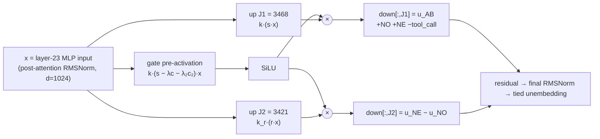

# Surgical Repair of Tool Calling in Qwen3.5-0.8B via a Two-Neuron Final-Layer Weight Edit

**6,142 BF16 parameters changed (0.00082 % of the 752 M text-model weights), three tensors in one layer, zero gradient steps.**

`Qwen/Qwen3.5-0.8B`, prompted with a native `<tools>` block, emits `<tool_call>` on almost every request that should *not* be a call: explanation requests ("explain what this operation does, do not run it") and requests whose required argument is explicitly missing (it writes the literal string `not provided` into the slot). This repository documents a mechanistic diagnosis of that failure and a closed-form weight edit that repairs it. Two near-dead neurons in the last MLP are re-purposed as a gated readout of features the model already computes but never uses. Everything is computed from captured activations with difference-of-means, orthogonalization and least squares; no backward pass, optimizer, LoRA or distillation was involved.

| | tool-context items (192) | non-tool items (64) |
|---|---|---|
| **correct (lenient)** | **68 / 192 → 155 / 192** | 28 / 32 → 28 / 32 short answers (32 / 32 token-identical) |
| **correct (strict)** | 30 / 192 → 118 / 192 | 32 / 32 prose answers intact (128-token, length unchanged) |
| **wrong → right / right → wrong** | **87 / 0** | 0 / 0 |
| required calls kept | 68 / 72 → 68 / 72 (71 / 72 token-identical) | |
| `NO_TOOL` on explanation requests | 0 / 60 → 59 / 60 | |
| `NEED_CLARIFICATION`, value explicitly missing | 0 / 30 → 28 / 30 | |
| `NEED_CLARIFICATION`, ambiguous "either X or Y" | 0 / 30 → 0 / 30 (known limit, see §4) | |

Paired, greedy, identical prompts and decoding for both weights. *Lenient* treats an omitted optional argument as equivalent to its explicit default; *strict* additionally requires no extra arguments (the base model's habit of adding `detail=brief` is neither fixed nor worsened by the edit). Item sets: 64 practice, 32 unseen-family selection, 64 renamed functions/arguments, 32 final-split family proxy. Full tables with every control: [results.md](results.md) §5.

> **Read this before using the numbers.** The benchmark is synthetic and campaign-generated: inert tool families (`enqueue`, `convert_meters_to_feet`, opaque `fx_57343`, ...), two confusable functions per prompt, distractor notes, and one fixed system prompt that instructs the literals `NO_TOOL` / `NEED_CLARIFICATION`. The edit was evaluated only under that protocol (official chat template, `enable_thinking=False`, greedy, ≤ 128 new tokens) on Apple-Silicon MLX. It is **not** evaluated on BFCL or any public tool benchmark, on multi-turn use, on other system prompts beyond one "concise" variant, or on vision inputs. The vision tower is byte-identical to the base and was never run.

---

## 1. What is wrong with the base model

At the decision position (the `\n\n` after the empty `<think></think>` block), `<tool_call>` leads `NO` by 2–15 logits on every non-call item, and `NO` leads `NE` by 0.5–5 logits. Once the first token is chosen, the rest of each literal follows with log-probability ≈ 0 (`NO → _TOOL`, `NE → ED → _CL → AR → IFICATION`), so the entire problem is a single first-token decision. Baseline on 64 practice items: 24/24 calls right, 0/20 explanation requests right (18 false calls, 2 prose), 0/20 missing-argument requests right (20 false calls, 10 of them with `not provided` written as the argument).

## 2. Where the evidence is, and where it is not (localization)

Captures were taken teacher-forced at the decision position on 60 token-length-matched teacher triples × {original, renamed names} and on the 64 practice items; all-position captures of the final-layer MLP input were taken for the generated continuations.

1. **No culprit neurons.** Direct logit attribution of every MLP neuron (24 layers × 3,584 = 86,016 neurons) to the `<tool_call> − NO` margin finds **no non-call-selective pusher above ≈ 0.2 logits**. The push toward calling is a distributed, class-independent prior written mostly by layers 14–23 (the layer-20 block adds ≈ 5–6 logits, layer 23 ≈ 2), and explanation requests receive almost the same push as genuine calls. There is nothing to ablate: the flaw is a **missing inhibition**, not a spurious excitation. (`analysis/dla.py`, `analysis/neurons.py`)
2. **The missing evidence already exists in the residual stream.** A difference-of-means direction *s* ("this is an explanation request") separates `NO_TOOL` items from calls with **d′ ≈ 10–14 at layers 12–16**, with zero overlapping practice cases, and is still linearly readable at the layer-23 MLP input. A second direction *r* ("clarify, don't explain") separates missing-argument from explanation requests with **d′ ≈ 10 at layers 8–13** and still separates them at the layer-23 MLP input (practice 0.79–2.23 vs ≤ 0.28). The model's own output never uses either: `NE − NO ≈ −2` for both classes. (`analysis/separability.py`, `analysis/features2.py`, `analysis/crosslayer.py`)
3. **The ambiguous variant has no feature.** Items offering `either "18" or "189", with no preference specified` are indistinguishable from complete calls at the output (margins 12.6–14.8 vs 13.9) and in every probed layer (leave-one-out probes d′ < 3). Nothing in the network represents "two candidate values"; a readout edit cannot create it.
4. **The write must be in the last layer.** Residual RMS grows from 0.07 (layer 14) to 0.38 (layer 24). A mid-layer write large enough to move the output by ≈ 15 logits would exceed the local residual norm and be reprocessed by nine layers. A layer-23 MLP write is scaled exactly once by the final RMSNorm, and because the KV cache is built from the layer *input*, it changes logits only at its own position.
5. **Name invariance.** Renamed teacher twins (fresh function and argument names, identical token lengths) give near-identical margins and features; every direction is teacher-derived and checked per case on practice before use.

## 3. The edit (`g23v3`)

Let *x* ∈ ℝ¹⁰²⁴ be the layer-23 MLP input (post-attention RMSNorm output). Two neurons that are near-dead everywhere (max |activation| ≤ 0.25 at every captured position), **J1 = 3468** (abstain readout) and **J2 = 3421** (route readout), get new rows in `gate_proj`/`up_proj` and new columns in `down_proj` of `model.language_model.layers.23.mlp`:

```
gate_proj[J1,:] = k·(s − λ·c − λ₂·c₂)      up_proj[J1,:] = k·s        down_proj[:,J1] = a₁·u_AB
gate_proj[J2,:] = k·(s − λ·c − λ₂·c₂)      up_proj[J2,:] = k_r·r      down_proj[:,J2] = a₂·(u_NE − u_NO)

act_J1(x) = SiLU(k·(s − λc − λ₂c₂)·x) · (k·s·x)     ≈ k²(s·x)²  at a tool-context decision position with s·x > 0, ≈ 0 elsewhere
act_J2(x) = SiLU(k·(s − λc − λ₂c₂)·x) · (k_r·r·x)   signed NE-vs-NO route, same gate

k = 2, k_r = 1, a₁ = a₂ = 1, λ = 0.3, λ₂ = 0.5          (edits/g23v3.spec.json)
```

```
                    x = layer-23 MLP input (d = 1024)
                    │
        ┌───────────┼─────────────────────────┐
        ▼           ▼                         ▼
  k·(s−λc−λ₂c₂)·x   k·(s·x)                 k_r·(r·x)
   "is this a       "how strongly            "clarify (+)
   tool-context     is it an                  or explain (−)?"
   decision with    abstention?"
   s·x > 0?"
        │           │                         │
      SiLU ──────── × ─────┐          ┌────── × ──────── SiLU (same gate)
                           ▼          ▼
                 down[:,J1] = u_AB     down[:,J2] = u_NE − u_NO
                 (+1 NO, +1 NE,        (+1 NE, −1 NO,
                  −1 <tool_call>,       0 on 39 competitors)
                  −0.5 I/To/The,
                  0 on 39 competitors)
                           │          │
                           └────┬─────┘
                                ▼
            residual → final RMSNorm → tied unembedding → logits
```



**The directions** (`edits/g23v3.vectors.npz`, all closed-form):

* **s** (abstain feature): unit difference of class means (abstain − call) at residual layer 18 on the teacher set, orthogonalized against the end-of-literal and first-continuation signatures (mean *x* at the last / first generated position of abstain items minus the call decision mean), then against `ref = μ_call + 0.5·(μ_abstain_clear − μ_call)` so that its zero-crossing sits midway between the call cluster and the clear-abstain cluster.
* **r** (route feature): unit difference of means (clarify − answer) at residual layer 14, orthogonalized against the midpoint of the explanation and explicit-missing clusters.
* **c** (tool-context gate term, λ = 0.3): unit(ortho(mean non-tool decision *x* − mean tool-context decision *x*, mean tool-context decision *x*)). `c·x` is −2.5…3.7 at tool-context decision positions but 17.9…24.7 at the first token of prompts *without* tools, so the gate shuts there.
* **c₂** (generated-position gate term, λ₂ = 0.5): the same construction with the mean over every captured *generated* position (literal continuations, positions inside tool calls, explanatory prose in tool contexts, and the model's own prose answers to 16 non-tool questions). `c₂·x` is −2.0…2.9 (sd 1.0) at tool-context decision positions but ≥ 9.3 at literal continuations, ≥ 12.4 inside calls, ≥ 10.1 at tool-context prose and ≥ 6.8 at non-tool prose positions. The gate therefore opens **only at the decision token of a tool-context prompt**; simulated |activation| is 0.00 at literal, in-call and non-tool first-token positions and exceeds 1.0 at only 6 of 1,953 non-tool prose positions (max 2.3).
* **u_AB** and **u_NE − u_NO**: minimum-norm least-squares directions in pre-final-norm residual space (rows E_t ⊙ γ_final, with γ_final = stored weight + 1 in the MLX convention) with unit logit effect (+1 `NO`, +1 `NE`, −1 `<tool_call>`, −0.5 on the prose starters `I`, `To`, `The`) resp. (+1 `NE`, −1 `NO`), and **zero effect on 39 competitor tokens** (`I To The No None Based This Since Select < <think> Please NOT no Not Need Sure Here Okay You It Yes 1 \n <|im_end|> _TOOL ED <|endoftext|> Hello Certainly Let For In If We A As There Of`). Norms 0.87 and 0.80.

Changed entries: 2,047 (`gate_proj`) + 2,047 (`up_proj`) + 2,048 (`down_proj`) = **6,142 of 752,393,024** text parameters (8.2 × 10⁻⁶; the campaign's limit was 0.25 %). An exact CPU simulator of the edit (final norm + tied unembedding on the captured *x*) predicted the real edited model's decision token on 64/64 calibration items (median |logit error| 0.06, max 0.38) before any generation pass was spent on it.

### 3.1 Progression v1 → v2 → g23v3 and the negative controls

| candidate | gate | output target | tool-context repair | non-tool behaviour |
|---|---|---|---|---|
| **v1** `g23_t05_a1.0` | `k·s` | ±1 on NO/NE/tool_call only | practice 24 → 52 (28/0) | one instruction prompt became `NENE`; **all 16 prose answers destroyed** (`NONENENE…`) |
| **v2** `g23v2` | `k·(s − 0.3c)` | adds −0.5 on `I`/`To`/`The` | practice 24 → 53 (29/0) | first tokens fixed (32/32 + 32/32 identical), but **prose still corrupted** (1/16 token-identical, `NO,NO,…` injections) |
| **g23v3** (final) | `k·(s − 0.3c − 0.5c₂)` | as v2 | practice 24 → 52 (28/0); 192-item total 68 → 155 (87/0) | 32/32 short answers identical; **32/32 prose intact**, lengths unchanged, 20/32 token-identical |

The v2-vs-v3 choice followed a decision rule written into `notes.md` *before* any v2 result was read (0 right→wrong everywhere, calls token-identical, no injected literal fragments, non-tool length within 10 %). v2 failed the prose clause; v3 was built to fix it and judged on 16 fresh prose questions never used in any derivation.

Controls on the same two neurons (64 practice items each; [results.md](results.md) §5 has every row):

| control | result |
|---|---|
| zero edit (neurons zeroed) | 24 → 24, **64/64 token-identical** to baseline |
| half dose (a₁ = a₂ = 0.5) | 24 → 52 |
| double dose (a₁ = a₂ = 2) | 24 → 53 (hits the post-literal leakage ceiling) |
| reversed sign (a₁ = a₂ = −1) | 24 → 24, **0 repairs**; the two baseline prose explanations become false calls |
| norm-matched random directions, seed 7 (v1 norms) | 24 → 24, 0 repairs, 60/64 identical |
| norm-matched random directions, seed 11 (v2 norms) | 24 → 24, 0 repairs, 57/64 identical |
| norm-matched random directions, seed 13 (v3 norms) | **24 → 12**: breaks 12 calls by writing a random direction inside tool calls |

A perturbation of this size on these neurons is at best harmless and never helpful unless it is the structured one. A fresh stock `mlx_lm` process loading the exported checkpoint reproduced the in-process token streams exactly (32/32 original, 32/32 edited).

## 4. Limitations and residual failures

* **Ambiguous requests** (`either "X" or "Y", with no preference specified`) are untouched: 0/30. No linear feature for "two candidate values" exists at any probed layer; the edit reads features, it cannot create one.
* **Weak-cue explanation requests** ("Describe this operation now: <op>. <values>") mostly stay calls (2/20 in simulation). The edit's reach scales with how strongly the model itself represents the request as explanatory.
* **Explicit-missing is phrasing-dependent**: `not provided`-style phrasings are repaired (28/30); other phrasings only when the model represents them as missing.
* One practice explanation item (meters-to-feet, a prose explanation at baseline) is repaired by v2 but not by v3; it fails gracefully (same prose as baseline).
* **Non-tool prose is not bit-identical** (20/32): a handful of generated positions still carry activations up to ≈ 2 units (≈ 5 logits on `NO`/`NE`), enough to flip near-tied word choices after which the text diverges benignly ("Bacteria are single-celled euka…" → "Bacteria are prokaryotic cells."). Short non-tool answers are identical.
* Inside tool calls the readout is not perfectly silent at near-tied positions: one correct renamed call drops its explicit optional default (still correct under both scorings). Across 72 paired calls no call changed correctness; the four calls wrong at baseline (renamed-set function-choice errors) stay wrong.
* Validated under two system-prompt framings (`standard`; `concise` for v2 only, 12 → 27 of 32), not under framings with format examples, multi-turn conversations, or tool results in context.

## 5. Quickstart (three ways)

**A. Download the patched checkpoint** from Hugging Face: [`scasella/Qwen3.5-0.8B-toolpatch-g23v3`](https://huggingface.co/scasella/Qwen3.5-0.8B-toolpatch-g23v3) (full HF-format checkpoint; only the three layer-23 tensors differ from `Qwen/Qwen3.5-0.8B` rev `2fc0636`).

```python
from mlx_lm import load, generate
from mlx_lm.sample_utils import make_sampler
model, tok = load("scasella/Qwen3.5-0.8B-toolpatch-g23v3")
SYSTEM = ("Use the available tools when needed. For a request requiring no tool, reply exactly NO_TOOL. If required information "
          "is missing or ambiguous, reply exactly NEED_CLARIFICATION. Otherwise make exactly one native tool call. No other text.")
tools = [{"type": "function", "function": {"name": "uppercase_text", "description": "Change stored text to uppercase.",
          "parameters": {"type": "object", "properties": {"text": {"type": "string", "description": "Stored text identifier"}}, "required": ["text"]}}}]
prompt = tok.apply_chat_template([{"role": "system", "content": SYSTEM},
                                  {"role": "user", "content": "Carry out this request: change stored text to uppercase.\nStored text identifier: not provided."}],
                                 tools=tools, add_generation_prompt=True, enable_thinking=False)
print(generate(model, tok, prompt, max_tokens=128, sampler=make_sampler(0)))   # -> NEED_CLARIFICATION
```

**B. Apply the 38 KB patch yourself** (≈ 2 s, numpy only). The script rebuilds the three tensors from `edits/g23v3.vectors.npz` + `edits/g23v3.spec.json`, copies the base checkpoint, overwrites only those tensors' bytes and verifies the SHA-256 of each edited tensor against the published values; `--full-hash` also checks the whole file (`886b4952…`).

```bash
BASE=$(hf download Qwen/Qwen3.5-0.8B --revision 2fc06364715b967f1860aea9cf38778875588b17)
python apply_g23v3.py --base "$BASE" --out Qwen3.5-0.8B-toolpatch-g23v3 --full-hash
```

Expected output:

```
gate_proj  cd759ae8a60c6cc2b5b7cbf397a03968464589f5490e11002028c6953d5c8429 OK
up_proj    b40609ff4db37fa3f97d3eeb8a7ffd1ab75bb2dc01eac36c2afa0ef9dcaad196 OK
down_proj  e4e9f7ead2e43fc920f9e91e44ef90a3f5ead92ca7d89f8a5c3774965abe9180 OK
file       886b4952cc74601ad69bed4488c9f4e5621e7dbb8a51287db2e6a4af60f2927e OK
```

Then run the six-case side-by-side demo (needs `mlx-lm` on Apple Silicon and the base model in your Hugging Face cache, or `--base <snapshot dir>`; ≈ 10 s after model load; edits are applied in-process from the vector files):

```bash
python demo_cli.py --check
```

`--check` compares every generation with the token streams recorded in `runs/` during the campaign (10/10 identical on the authors' machine). Cases: a required call (preserved token-for-token), an explanation request (`<tool_call>` → `NO_TOOL`), an explicit missing value (`<tool_call>` with `not provided.` as the argument → `NEED_CLARIFICATION`), a renamed/opaque tool pair (the base model picks the wrong function *and* invents the missing item → `NEED_CLARIFICATION`), an ambiguous "either 18 or 189" request (both models call: the known limit), and a free-form 128-token prose question with no tools, shown for original / v1 / g23v3:

```
6. Free-form prose, no tools (128 tokens)
  user    | What are the main differences between bacteria and viruses?
  original | The primary differences between bacteria and viruses can be categorized into **cell structure**, ...
  v1       | NONENENENENENENENENENENENENENENENENENENENENENENENENENENENENENENENENENENENENENENENENENENENENENENE...
  g23v3    | The primary differences between bacteria and viruses can be categorized into **cell structure**, ...
           | (128 tokens; token-identical to original)
```

**C. Reproduce the investigation** (47 budgeted forward passes, Apple Silicon, MLX). Create a venv from `requirements.txt`, download the base revision above, and point `BASE` in `runtime/common.py` at your snapshot directory (the one machine-specific path in the harness; campaign code is otherwise left exactly as it ran). Every forward pass is one hash-chained request in `ledger.jsonl`; `fp.py` refuses to run without a hypothesis/prediction string, and `primitives.py` refuses edits outside the task's scope (≤ 2 layers, ≤ 8 tensors, ≤ 0.25 % of entries, no whole-tensor rescaling). Full command list: [results.md](results.md) §7. In short:

```bash
P=.venv/bin/python
$P build_data.py && $P build_extra.py                                   # deterministic item sets
$P fp.py generate --set practice --model original --label p01_baseline --hypothesis ... --prediction ...
$P fp.py teacher  --set teacher  --model original --label p05_teacher_allpos --mlpin 21,22,23 --colstats 21,22,23 ...
$P -m analysis.dla ; $P -m analysis.separability ; $P -m analysis.crosslayer ; $P -m analysis.leak2
$P build_g23.py --label g23v3 --a1 1.0 --a2 1.0 --t 0.5 --lam 0.3 --lam2 0.5 --prose_target 0.5
$P fp.py generate --set selection --model both --edit g23v3 --label p40_v3_sel_both ...
$P stock_reload.py --edit g23v3 --set practice --ids data/practice_stock.ids --label p44_v3_stock --compare p38_v3_gen_practice
```

The raw activation captures (`runs/*.npz`, 674 MB) and the full exported checkpoints (`artifacts/`, 1.7 GB each) are not in this repository; every per-pass summary (`runs/*.json`), the ledger, the notebook and every candidate's closed-form vectors are. All 12 candidates and controls rebuild bit-exactly from their `edits/<label>.vectors.npz` + `.spec.json` via `apply_g23v3.build` (verified against the original `.npz` snapshots).

## 6. Repository layout

```
apply_g23v3.py        standalone patcher (numpy only): vectors + spec -> edited tensors -> verified checkpoint copy
demo_cli.py           six-case side-by-side demo, --check against recorded runs
edits/                g23v3.npz (final edit, BF16 bits of the 3 tensors), *.spec.json (every scalar + receipts + simulation),
                      *.vectors.npz (s, r, c, c2, u_AB, u_route, gate_dir) for the final edit and all 11 controls/candidates
results.md            final report: diagnosis, localization, edit, controls, paired tables, limitations, accounting, commands
notes.md              running notebook: hypothesis and prediction before each pass, outcome after, decision rule, final state
ledger.jsonl          hash-chained append-only record of every budgeted request, execution and failure (47/50 passes)
runs/                 per-pass outputs: every prompt hash, raw output, token ids, score, memory (JSON); logs
data/                 deterministic item sets (practice, selection, final_proxy, renamed, teacher, regression, prose) + id lists
fp.py                 forward-pass tool: generate / teacher-forced capture, paired scoring, edit application and reversion
primitives.py         scoped BF16 edit API with on-disk persistence (NAMES, load, load_original, save_edit, drop_edit, snapshot)
build_g23.py          builds the edit from captures in closed form; --simulate_only runs the exact CPU simulator
build_data.py, build_extra.py   item-set generators
stock_reload.py       exports a full checkpoint and reruns it in a fresh stock mlx_lm process (imports nothing from here)
analysis/             CPU-only localization: lens, dla, neurons, separability, features2, crosslayer, leak/leak2, simulate, pair, tables
benchmark/ eval/ runtime/ patches/ interventions/ environment/   harness reused from the earlier campaigns (renderer, strict scorer,
                      budget + lock + memory guard, safetensors inspection, architecture manifest)
scripts/publish_release.sh      GitHub + Hugging Face publication (dry run by default)
```

## 7. Accounting and provenance

47 of 50 budgeted passes (2,619 charged executions, 1.43 M input / 93.5 k generated tokens); three passes were charged without results (two memory-guard aborts while a sibling job shared the machine, one import-shadowing bug in the stock worker), all recorded in `ledger.jsonl` and `notes.md`. Peak process RSS 3.46 GiB, backend (Metal) peak 1.85 GiB. One resident model at a time under an advisory file lock. Prompts, template, decoding and post-processing were identical for original and edited weights in every pass. Base model: `Qwen/Qwen3.5-0.8B` revision `2fc06364715b967f1860aea9cf38778875588b17`, safetensors SHA-256 `04b1c301…e4696`; MLX 0.32.4, mlx-lm 0.32.2, transformers 5.22.1.

## License

Code, data and records: Apache-2.0 ([LICENSE](LICENSE)). The edited tensors are derived from Qwen3.5-0.8B (Apache-2.0, © Alibaba Cloud).
