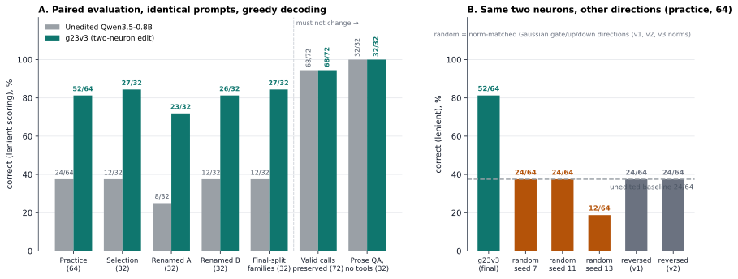
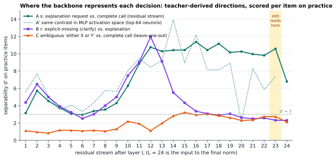
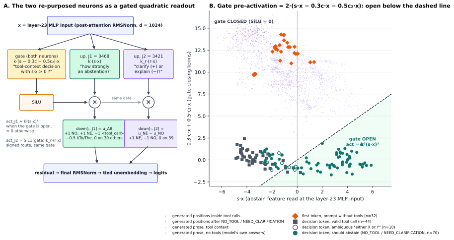
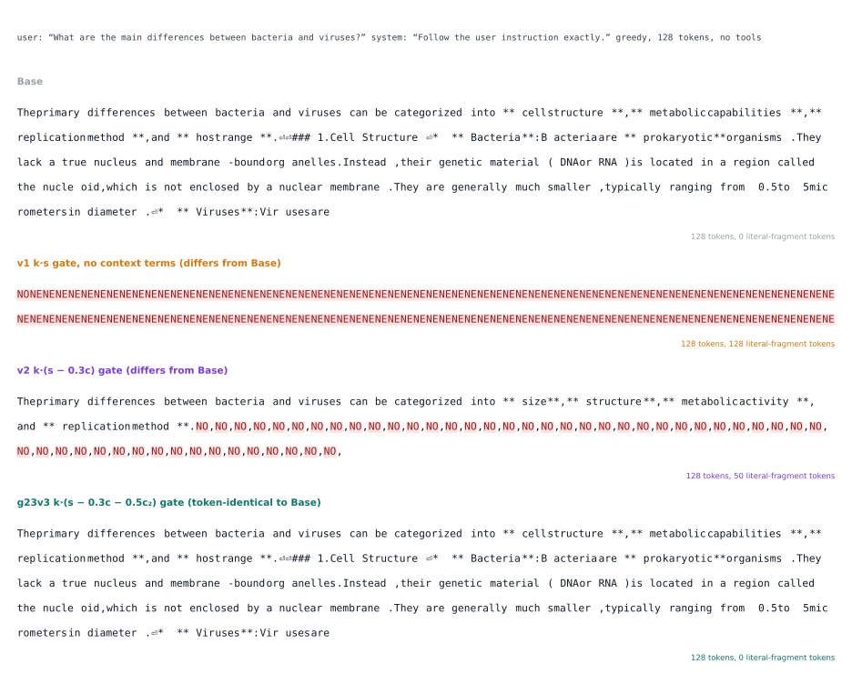

# Rewiring Two Dead Neurons: Fixing Trigger-Happy Tool Calling in Qwen3.5-0.8B Without Training

*How an AI agent diagnosed a missing inhibition circuit in Qwen3.5-0.8B and hand-wired a 2-neuron SwiGLU AND-gate in Layer 23 (0.00082% of weights) on an M4 Pro MacBook.*

**Stephen Casella (scasella) and Claude (Anthropic), November 4, 2026.** Code, data and the edited checkpoint: [github.com/scasella/qwen3.5-toolpatch](https://github.com/scasella/qwen3.5-toolpatch) · [huggingface.co/scasella91/Qwen3.5-0.8B-toolpatch-g23v3](https://huggingface.co/scasella91/Qwen3.5-0.8B-toolpatch-g23v3)

**TL;DR.** `Qwen/Qwen3.5-0.8B` emits `<tool_call>` on almost every request made while a `<tools>` block is in the system prompt, including requests to *explain* an operation and requests whose required argument is explicitly *missing* (it writes the literal string `not provided` into the slot). We traced the failure to a **missing inhibition**, not a spurious excitation: the model linearly represents "this is an explanation request" (d′ ≈ 10–11) and "the required value is missing" (d′ ≈ 10) in its middle layers, but never wires either representation to the output. We then **re-purposed two near-dead neurons of the last MLP layer** into a gated quadratic readout that does the wiring: 6,142 BF16 entries, three tensors, one layer, every number computed in closed form from captured activations and the weights, **zero gradient steps**. On 192 paired tool-context prompts the edited model goes from 68 to 155 correct (lenient scoring; 30 → 118 strict) with 87 wrong→right and **0 right→wrong**, keeps every valid tool call, and leaves 32 short non-tool answers and 32 128-token prose answers intact. The method cannot fix what the backbone does not compute: ambiguous "either X or Y" requests stay at 0/30, and a probe for that concept never exceeds d′ ≈ 3 at any layer. Everything ran on one Apple M4 Pro laptop in about three hours, under a hash-chained ledger of 47 budgeted forward-pass runs.

This post is modeled on MIT CSAIL's [*Sparks of Weight-Space Programming*](https://rikiyat.github.io/blog/weight-space-programming/) (Takehi, Teoh, Zhang and Khattab, November 2026), which showed an LLM reading and editing network weights without an optimizer and, in its headline experiment, fixing reasoning loops in the same Qwen3.5-0.8B by subtracting one direction from 64 output columns in two MLP layers (131,072 weights, 0.016%). Our edit is a different kind of object: instead of *removing* a direction, it *adds* a small circuit, and it is roughly twenty times smaller. Like that post, this is a blog post with early results, not a peer-reviewed paper. The benchmark is synthetic, and every caveat in Section 5 is load-bearing.



**Figure 1.** *Left:* paired lenient accuracy of the unedited model and the final edit `g23v3` on the five tool-context sets (practice, held-out selection families, two halves of a renamed-tools set with fresh function and argument names, and a proxy for the final-split families never used in localization), plus the two things the edit must not change: the 72 valid tool calls in those sets (68 correct before and after, 71 of 72 token-identical) and 32 non-tool prose questions (16 used to derive one gate direction, 16 fresh; all 32 intact). *Right:* the same two neurons loaded with other directions on the 64 practice items. Norm-matched random Gaussian directions give zero repairs (seed 13 breaks 12 valid calls); the reversed-sign edit gives zero repairs. Every bar is read from the per-run JSON in `runs/` by `scripts/make_blog_figures.py`.

## 1. The problem: trigger-happy small models

Give a 0.8B instruction model a `<tools>` declaration and a system prompt that says "use the available tools when needed; reply exactly `NO_TOOL` for a request requiring no tool; reply exactly `NEED_CLARIFICATION` if required information is missing or ambiguous", then ask it to *explain* what an operation does. It calls the tool. Ask it to run an operation whose required argument the request explicitly says is "not provided". It calls the tool, with the string `not provided` as the argument value. Our practice set has 64 items in 18 task families (half with opaque function and argument names, with distractor notes and three request phrasings): 24 required calls, 20 explanation requests, 20 missing-or-ambiguous requests. The baseline numbers are:

| class (practice, n = 64) | correct, lenient | what the model does |
|---|---|---|
| required call (24) | 24/24 (strict 7/24: 17 add the optional default `detail=brief`) | 24 calls |
| explanation → `NO_TOOL` (20) | 0/20 | 18 false `<tool_call>`, 2 prose explanations |
| missing/ambiguous → `NEED_CLARIFICATION` (20) | 0/20 | 20 false `<tool_call>`: 9 write the literal `not provided` as an argument value (one into an integer slot), the 10 ambiguous items silently pick one of the two offered values, one calls with another made-up value |

Across all 192 tool-context items (practice + selection + renamed + final-split proxy), explanation requests are 0/60 and clarification requests are 0/60. The valid calls are fine (68/72 lenient), so this is not a model that cannot call tools. It is a model that cannot *not* call them.

The failure is a first-token decision. At the decision position (the newline after the empty `<think></think>` block that the template emits with thinking disabled), `<tool_call>` leads `NO` by 2–15 logits on every one of the 40 non-call items, and `NO` leads `NE` (by up to 5 logits) on 38 of them. Once the first token of a literal is forced, the rest follows with log-probability ≈ 0 (`NO`→`_TOOL`, `NE`→`ED`→`_CL`→`AR`→`IFICATION`). Whatever we do, it has to move exactly one logit margin at exactly one position, and it must not move it on the 72 prompts that *should* call a tool.

The obvious shortcuts are wrong. Globally suppressing `<tool_call>` breaks every real call. Prompt engineering is not available in the evaluation protocol (one fixed system prompt, no format examples). And "just fine-tune it" is the question this post is trying to avoid: can the fix be *written* rather than *trained*, and can it be small enough to audit entry by entry?

Protocol for everything below: the official chat template with native `<tools>`, `enable_thinking=False`, greedy decoding, at most 128 new tokens, context ≤ 2048, one fixed system prompt. *Lenient* scoring is semantic correctness with an omitted optional default treated as equal to the explicit default; *strict* additionally forbids extra arguments. We always report both; the decision mechanism is identical under both.

## 2. Diagnosis, and the surprise in direct logit attribution

The campaign had a budget of 50 forward-pass runs of at most 64 prompts each, every one pre-registered with a hypothesis and a prediction in `notes.md` and charged to a hash-chained ledger. The first five (`p01`–`p05`) were spent on diagnosis:

- `p01` baseline generation on practice (the table above).
- `p02`/`p03` teacher-forced captures at the decision position for 60 token-length-matched *teacher triples* (call / explanation / missing, each in an original and a renamed-names twin, all six prompts in a group having identical token length) and for the 64 practice items: every residual stream (25 × 1024), every MLP activation (24 × 3584), the layer-23 attention inputs, and the full logits.
- `p04c`/`p05` all-position captures of the final-layer MLP input (the thing a layer-23 neuron actually sees) for every prompt and every generated token of the gold continuation.

Two forward-pass runs were lost to a memory guard that fired because a sibling campaign shared the machine; the ledger records them as charged.

**Looking for culprits.** The natural hypothesis for "the model calls tools too eagerly" is that some neurons push `<tool_call>` when they should not. Direct logit attribution answers this exactly: at the decision position, the contribution of MLP neuron *j* of layer *l* to the `<tool_call>` − `NO` margin is its activation times `down_proj[:, j]` projected through the final RMSNorm and the tied unembedding, so we can rank all 24 × 3584 = 86,016 neurons by how much *more* they push the call on non-call items than on real calls. The answer is: nobody does. The largest non-call-selective pusher in the entire network is worth **+0.20 logits** (layer 22, neuron 1110). The call push is real (layers 14–23 write the margin; the layer-23 MLP alone adds 1–3 logits), but it is a distributed, class-independent prior: explanation requests receive almost the same push as real calls. There is nothing to ablate. The bug is not a spurious excitation. It is a **missing inhibition**.

**Looking for the missing evidence.** If the model does not inhibit the call, does it at least *know* it should? We took the difference of class means on the teacher triples, at every layer, and scored each practice item by its projection on that direction, reporting the separability d′ (difference of class means over pooled standard deviation) on the practice set, never on the set the direction came from.



**Figure 2.** Per-layer separability of the three concepts the fix needs, scored per item on the 64 practice prompts using directions derived on the 60 teacher prompts. **A** (teal): "explanation request" vs. "complete call" in the residual stream is d′ ≈ 10–11 from layer 12 onward (11.4 at layer 16, 10.6 entering the final norm after layer 23) with zero overlapping practice items; the dotted curve reads the same contrast in MLP activation space (top-64 neurons by teacher d′) and reaches 13.9 at layer 14. **B** (purple): "required value explicitly missing" vs. "explanation" peaks at d′ = 12.0 at layer 12 and is above 7 from layers 10–13, then fades to ≈ 2.5 by layer 20; the model's own output never uses it (the `NE` − `NO` margin is ≈ −2 for both classes). **C** (orange): "ambiguous, two candidate values" vs. "complete call", which has no teacher items and is therefore scored by a leave-one-out difference of means within practice, never exceeds d′ = 3.2 at any layer. Layer 0 (token embeddings, identical across the matched prompts) is omitted.

So the representation of "you should abstain" exists, cleanly, in the second half of the network, and the representation of "and specifically because something is missing" exists in the first half and is still linearly readable later. What is missing is the last step: a readout that turns those features into logits. That is a job description for a neuron.

## 3. Why layer 23, and why two dead neurons

Three facts fixed the design.

**Residual norm growth.** The RMS of the residual stream at the decision position grows from 0.07 after layer 14 to 0.38 entering the final norm (0.10 at layer 16, 0.20 at layer 20, 0.29 at layer 23). Moving the output margin by the ≈ 15 logits that the worst non-call items need corresponds to a write of order 4 in pre-final-norm residual units. A mid-layer write of that size would exceed the entire residual norm at layers 12–16 (≈ 2.2) and then be reprocessed by nine more layers of attention and MLP; it would also enter every downstream key/value and recurrent-state cache at that position. A write from the **layer-23 MLP** is scaled exactly once (by the final RMSNorm) and, because every downstream cache is built from the layer *input*, changes nothing but the logits at the position where it fires. This is also what makes the edit cheap to reason about: no attention head ever sees it.

**Dead neurons are free real estate.** Among the 3,584 neurons of the layer-23 MLP, some never do anything measurable. Neurons **J1 = 3468** and **J2 = 3421** have a maximum absolute activation of 0.25 at every one of the 76,154 captured positions (prompts, decision tokens, literal continuations, tool-call bodies, prose). Replacing their input rows and output columns removes a contribution that the exact simulator confirms is negligible everywhere, and costs no capacity the model was using.

**SwiGLU gives you an AND gate for free.** A SwiGLU neuron computes `SiLU(gate·x) · (up·x)`, then writes `down[:, j]` times that scalar into the residual. Programming all three of its weight vectors at once gives a tiny program:

```
gate_proj[J1, :] = k · (s − λ·c − λ₂·c₂)      up_proj[J1, :] = k · s        down_proj[:, J1] = a₁ · u_AB
gate_proj[J2, :] = k · (s − λ·c − λ₂·c₂)      up_proj[J2, :] = k_r · r      down_proj[:, J2] = a₂ · (u_NE − u_NO)

act_J1(x) = SiLU(k·(s − λc − λ₂c₂)·x) · (k·s·x)    ≈ k²(s·x)²  at a tool-context decision position with s·x > 0,  ≈ 0 elsewhere
act_J2(x) = SiLU(k·(s − λc − λ₂c₂)·x) · (k_r·r·x)  a signed route (NEED_CLARIFICATION vs. NO_TOOL), behind the same gate

k = 2,  k_r = 1,  a₁ = a₂ = 1,  λ = 0.3,  λ₂ = 0.5        (edits/g23v3.spec.json)
```

Here *x* ∈ ℝ¹⁰²⁴ is the layer-23 MLP input (the post-attention RMSNorm output) and the directions are:

- **s**, the *abstain* feature: the unit difference of class means (abstain − call) in the residual stream after layer 18 on the teacher set, orthogonalized against the end-of-literal and first-continuation signatures (so the readout is quiet right after it has emitted a literal) and against `μ_call + 0.5·(μ_abstain − μ_call)` so that its zero crossing sits midway between the call cluster and the clear-abstain cluster.
- **r**, the *route* feature: the unit difference of means (clarify − explain) after layer 14, orthogonalized against the midpoint of the two clusters.
- **c**, the *tool-context* gate term: unit(ortho(mean non-tool first-token *x* − mean tool-context decision *x*, mean tool-context decision *x*)). `c·x` is −2.5…3.7 at tool-context decision positions and 17.9…24.7 at the first token of a prompt with no tools declared.
- **c₂**, the *generated-position* gate term: the same construction with the mean over every captured generated position. `c₂·x` is −2.0…2.9 at tool-context decision positions, ≥ 9.3 (1st percentile) at literal continuations, ≥ 12.4 inside tool calls, ≥ 10.1 at explanatory prose in tool contexts and ≥ 6.8 (1st percentile; minimum 3.3) at the model's own prose answers to non-tool questions.
- **u_AB** and **u_NE − u_NO**, the *output* directions: minimum-norm least-squares vectors in pre-final-norm residual space (rows `E_t ⊙ γ_final`) with unit logit effect (+1 `NO`, +1 `NE`, −1 `<tool_call>`, −0.5 on the prose starters `I`, `To`, `The`) resp. (+1 `NE`, −1 `NO`), and **zero effect on 39 competitor tokens** (`I To The No None Based This Since Select < <think> Please NOT no Not Need Sure Here Okay You It Yes 1 \n <|im_end|> _TOOL ED <|endoftext|> Hello Certainly Let For In If We A As There Of`).

The quadratic form is deliberate. A linear readout `SiLU(gate·x)·(up·x)` with a position selector in the gate and the signed feature in the up-projection cannot carry a bias, leaks about 20% at continuation positions, and flips one genuinely odd borderline call (an interval request whose lower bound exceeds its upper bound; the model's abstain feature is mildly positive there, which is sensible). Squaring the feature keeps that call (its margin stays ≥ 1.26 logits in simulation) while giving the clear abstentions activations of 7–150, enough to swing the margin by the required tens of logits after the final norm.



**Figure 3.** *Left:* the two re-purposed neurons as a circuit. Both share one gate; J1 squares the abstain feature and writes "+NO +NE −tool_call", J2 multiplies the gate by the signed route feature and writes "+NE −NO". *Right:* every captured layer-23 MLP input, projected on `s` (horizontal) and on the gate-closing terms `0.3·c + 0.5·c₂` (vertical). The gate pre-activation is `2·(s·x − 0.3·c·x − 0.5·c₂·x)`, so the gate is open below the dashed diagonal. Decision tokens that should abstain (teal, n = 70) sit in the open region with `s·x` up to 5.9; decision tokens of valid calls (grey squares, n = 44) have `s·x ≤ 0.26` and stay closed; the first token of prompts without tools (orange diamonds, n = 32) is pushed far up by `c`; every generated position (purple: inside tool calls, after a literal, prose in tool contexts, the model's own non-tool prose; 1,880 of the 4,838 positions, randomly subsampled) is pushed up by `c₂`. The simulated |activation| is 0.00 at every literal, in-call and non-tool first-token position and exceeds 1.0 at only 6 of 1,953 non-tool prose positions (maximum 2.3). The ambiguous items (hollow circles) sit among the calls: the gate is closed for them because `s` does not see them, which is Section 5.

Changed entries: 2,047 in `gate_proj` + 2,047 in `up_proj` + 2,048 in `down_proj` (the two rows and columns, minus the entries that happened to round to the same BF16 value) = **6,142 of 752,393,024** text parameters, 8.2 × 10⁻⁶ = 0.00082%. Every direction is a difference of means, an orthogonalization or a least-squares solve on captured activations; nothing was fit to task outputs, and the simulator that chose the constants is under 90 lines of numpy.

## 4. The engineering story: v1 → v2 → g23v3, and predictive simulation

**Simulate before you spend.** Because the write lives in the last MLP, its effect on the logits at the decision position can be computed exactly on CPU from the captured MLP input *x*, the captured pre-final-norm residual, the final norm weights and the embedding matrix: remove the two neurons' original contribution, add the new one, renormalize, unembed. We built the first candidate (**v1**: `gate = k·s`, no context terms, output target ±1 on `NO`/`NE`/`<tool_call>` only) against this simulator and then spent one teacher-forced run (`p06`) to calibrate it: the real edited model's decision argmax agreed with the simulation on **64/64** practice items, with a median absolute logit error of **0.06** and a maximum of 0.38; inside tool calls no continuation token changed rank. v2 and v3 differ from v1 only in the gate direction and the output target, so they were taken straight to generation, where every simulated prediction (which items flip, which call is borderline, which non-tool prompt breaks at a given dose) was borne out.

**v1 worked on the benchmark and failed outside it.** On practice, v1 went 24 → 52 lenient with 28 wrong→right, 0 right→wrong and all 24 calls token-identical; selection 12 → 26; renamed 8 → 24 and 12 → 26. The controls behaved: a zero edit reproduced the baseline token for token (64/64), half dose 52, double dose 53 (with two post-literal `NENONONENE…` degenerations, the leakage ceiling), reversed sign 24 with zero repairs, norm-matched random directions 24 with zero repairs. Then we ran prompts with **no tools declared**. One instruction prompt ("Reply with exactly the word cedar24…") became `NENE`, which the simulation had flagged as the single highest abstain-feature value among non-tool prompts. Worse, on 16 prose questions v1 destroyed **all 16** answers: `NONENENENE…` from the first token. The abstain feature `s` is not specific to tool contexts. It stays positive while the model explains anything, and a quadratic readout with no bias happily fires on it for 128 tokens.

**v2: a tool-context gate.** Adding the context term (`gate = k·(s − 0.3·c)`) closes the gate at the first token of non-tool prompts (`c·x` ≥ 17.9 there), and adding −0.5 on the prose starters `I`/`To`/`The` to the output target raised the borderline call's margin from 1.44 to 2.05 and turned two weak explicit-missing items from degenerate prose into clean literals. v2 scored 24 → 53 on practice, 32/32 token-identical on the non-tool regression suite and 32/32 on a fresh-seed suite. It passed every tool-context clause of a selection rule that had been written into `notes.md` *before* any v2 result was read. But it still corrupted the prose: 1 of 16 long answers token-identical, 4 of 16 wrong, with `NO,NO,NO…` injected mid-essay. The decision-derived term `c` is small at *generated* positions (−0.6…7.9 in tool-context prose), and `s·x` stays positive throughout an explanation.

**g23v3: a generated-position gate.** One more capture (`p35`, the model's own prose answers to the 16 questions) gave the second term. `c₂` is the mean over *all* captured generated positions minus the tool-context decision mean, orthogonal to that mean, and it is ≥ 6.8 at 99% of non-tool prose positions while staying within ±3 at tool-context decisions. `gate = k·(s − 0.3·c − 0.5·c₂)` therefore opens only at the decision token of a tool-context prompt. The constant 0.5 is the largest that keeps the borderline inverted-interval call a call (its `c₂·x` is negative); larger values close the last six leaking prose positions and flip that call. g23v3 was then judged on 16 *fresh* prose questions never used in any derivation (16/16 intact), the original 16 (16/16), the fresh-seed non-tool suite (32/32 token-identical), and the full tool-context battery.



**Figure 4.** One non-tool prose question under the base model and the three candidates, greedy, 128 new tokens, red = literal-fragment tokens. v1 collapses on the first token. v2 starts clean and collapses after the first paragraph, once the model has settled into explaining (the `c` term no longer protects generated positions). g23v3 is token-identical to the base model. The same script verified that, for a question from the recorded fresh prose set (`prose2-07` in run `p36`, 16/16 intact), its base and g23v3 streams match the recorded ones token for token; the v1 and v2 traces were generated for this figure with `demo_cli.py`'s machinery under the campaign protocol, not as budgeted passes, and are stored in `docs/figures/fig4_trace.json`.

The final battery for g23v3, all paired on identical prompts:

| set (n) | lenient | strict | calls kept | NO_TOOL | NEED_CLAR. | wrong→right / right→wrong |
|---|---|---|---|---|---|---|
| practice (64) | 24 → 52 | 7 → 35 | 24/24, all token-identical | 0 → 19 of 20 | 0 → 9 of 20 | 28 / 0 |
| selection, unseen families (32) | 12 → 27 | 4 → 19 | 12/12 | 0 → 10 of 10 | 0 → 5 of 10 | 15 / 0 |
| renamed A (32) | 8 → 23 | 6 → 21 | 8/12 (4 wrong before and after) | 0 → 10 of 10 | 0 → 5 of 10 | 15 / 0 |
| renamed B (32) | 12 → 26 | 10 → 25 | 12/12 | 0 → 10 of 10 | 0 → 4 of 10 | 14 / 0 |
| final-split proxy (32) | 12 → 27 | 3 → 18 | 12/12 | 0 → 10 of 10 | 0 → 5 of 10 | 15 / 0 |
| **all tool-context (192)** | **68 → 155** | **30 → 118** | **68/72** (71/72 token-identical) | **0 → 59 of 60** | **0 → 28 of 60** | **87 / 0** |
| fresh non-tool short answers (32) | 28 → 28 | 28 → 28 | — | — | — | 0 / 0, 32/32 token-identical |
| non-tool prose, derivation set (16) | 16 → 16 | | | | | 0 / 0, lengths 122.1 → 122.1 tokens |
| non-tool prose, fresh (16) | 16 → 16 | | | | | 0 / 0, lengths 127.9 → 128.0 tokens |

False calls over the 192 items fall from 114 to 33. The strict/lenient gap is the base model's pre-existing habit of adding the optional default argument; the edit neither fixes nor worsens it, and the strict transition counts are identical to the lenient ones. A fresh, stock `mlx_lm` process that loads the exported checkpoint (with no campaign code imported) reproduces the in-process token streams exactly, 32/32 original and 32/32 edited.

## 5. What weight-space editing cannot do: the "either X or Y" boundary

Twenty of the 60 clarification items are explicit: the request says the required value is "not provided". Thirty are *ambiguous*: the request offers two candidate values, `either "X" or "Y", with no preference specified`, and the correct behaviour is to ask. The edit repairs 28 of the 30 explicit items and **0 of the 30 ambiguous ones**. It was never going to repair them, and Figure 2 says why: at the output, ambiguous items are indistinguishable from complete calls (margins 12.6–14.8 vs. 13.9 for calls), and at every probed layer a leave-one-out probe for "two candidate values" tops out at d′ ≈ 3.2, against ≈ 10 for the two concepts the edit reads. Nothing in the 0.8B network represents "I was given two values for one slot" as a feature; the model simply picks one value and proceeds, and Figure 3 shows those items sitting inside the call cluster where `s` cannot see them.

This is the general limit of the method. A readout edit can only surface a representation the backbone already computes. It can add the missing last step of a circuit; it cannot add the circuit. The same limit shows up softly elsewhere: weak-cue explanation requests ("Describe this operation now: <op>. <values>") mostly stay calls because the model itself barely represents them as explanatory (2 of 20 flipped in simulation), explicit-missing phrasings other than "not provided" are repaired only when the model represents them as missing, and one practice item that v2 repaired is not repaired by v3 because its `c₂·x` jitter lowers its gate value (it fails gracefully, with the same prose as the baseline).

Two residual imperfections are worth stating plainly. Non-tool prose is not bit-identical (20 of 32 answers are; the rest diverge late into benign paraphrases, e.g. "Bacteria are single-celled euka…" → "Bacteria are prokaryotic cells.") because a few generated positions still carry activations up to ≈ 2 units, about 5 logits on `NO`/`NE`, enough to flip a near-tied word choice. And inside tool calls the readout is not perfectly silent at near-tied positions: one correct renamed call drops its explicit optional default (still correct under both scorings). The edit was validated under two system-prompt framings (`standard`, and `concise` for v2), not under framings with format examples, multi-turn conversations or tool results in context. The benchmark is synthetic; "0 right→wrong on 192 items" is a statement about this protocol, not about tool use in the wild.

## 6. Ledger, cost and reproducibility

**Hardware.** One MacBook Pro with an Apple M4 Pro and 24 GB of unified memory, running MLX 0.32.4 / MLX-LM 0.32.2 on the unquantized BF16 checkpoint, sharing its GPU with a concurrently running sibling campaign through a polled advisory lock. Peak process RSS was 3.46 GiB and peak Metal allocation 1.85 GiB, measured separately and never summed. No cloud, no GPU cluster, no gradients.

**Budget.** 47 of 50 budgeted forward-pass runs were used: 2,619 charged executions (2,585 completed), 1,431,007 prompt tokens and 93,537 generated tokens, about three hours of wall-clock time on November 4, 2026. Three runs were charged without producing results (two memory-guard aborts caused by the sibling campaign, one stock-reload worker that shadowed the standard library's `inspect` module), and the ledger records them. Every run is one `request` event in `ledger.jsonl` with its hypothesis and prediction written *before* execution, followed by one `reserve`/`usage` pair per prompt with token counts and memory readings; each of the 5,307 entries carries the SHA-256 of the previous entry, and the chain verifies end to end.

**The whole investigation was run by an AI agent.** Claude (Anthropic) operated the harness autonomously on the laptop: it chose the captures, wrote the analysis and simulation code, derived the directions, decided on v1 → v2 → v3, pre-registered each run, and wrote the lab notebook (`notes.md`) and the report (`results.md`). The human author set the task, the budget and the immutability rules, and reviewed the results. This post, its figures and the figure script were written by the agent from the recorded data, with the historical records (`runs/`, `ledger.jsonl`, `notes.md`, `edits/`) left untouched.

**Reproduce the edit in one command.** The patcher is a 67-line numpy script. It reads the 38 KB of vectors and the spec, rebuilds the three tensors in closed form, verifies the SHA-256 of the base tensors it is about to replace, writes a full checkpoint, and verifies the SHA-256 of the result against the published export:

```bash
hf download Qwen/Qwen3.5-0.8B --revision 2fc06364715b967f1860aea9cf38778875588b17 --local-dir base
python apply_g23v3.py --base base --out Qwen3.5-0.8B-toolpatch-g23v3 --full-hash
```

The rebuilt file hashes to `886b4952cc74601ad69bed4488c9f4e5621e7dbb8a51287db2e6a4af60f2927e`, bit-for-bit the checkpoint on the Hub. `demo_cli.py --check` then runs six representative prompts (a valid call, an explanation request, an explicit-missing request, a renamed-tool pair, an ambiguous request, and a 128-token prose question) through the original and edited weights in one process and compares the token streams with the recorded campaign runs (10/10 identical on our machine). The full reproduction, from data generation through every capture, analysis and generation run, is listed in `results.md` §7.

## Logs and artifacts

- Repository with code, data, per-run outputs (`runs/*.json`), the hash-chained ledger, the lab notebook and the report: [github.com/scasella/qwen3.5-toolpatch](https://github.com/scasella/qwen3.5-toolpatch)
- Edited checkpoint (full HF-format checkpoint; only the three layer-23 tensors differ), vectors, spec and patcher: [huggingface.co/scasella91/Qwen3.5-0.8B-toolpatch-g23v3](https://huggingface.co/scasella91/Qwen3.5-0.8B-toolpatch-g23v3)
- Figures in this post and the numbers behind them: `docs/figures/` and `docs/figures/figure_data.json`, generated by `scripts/make_blog_figures.py` from `runs/`.

## Acknowledgements

The framing of this post, and the question it tries to answer, come from *Sparks of Weight-Space Programming* by Rikiya Takehi, Jayden Teoh, Alex Zhang and Omar Khattab (MIT CSAIL). The base model is `Qwen/Qwen3.5-0.8B` by the Qwen team at Alibaba Cloud, used under the Apache 2.0 license; the edited tensors are derivative of it.

## Citation

```bibtex
@misc{casella2026twoneurons,
  title        = {Rewiring Two Dead Neurons: Fixing Trigger-Happy Tool Calling in Qwen3.5-0.8B Without Training},
  author       = {Casella, Stephen and {Claude (Anthropic)}},
  year         = {2026},
  month        = nov,
  howpublished = {\url{https://github.com/scasella/qwen3.5-toolpatch}},
  note         = {Blog post; model at \url{https://huggingface.co/scasella91/Qwen3.5-0.8B-toolpatch-g23v3}}
}
```

## Verification summary

Every quantitative claim in this post was re-derived from the recorded run files (`runs/*.json`, `runs/*.npz`), the data files (`data/*.jsonl`), the edit spec and vectors (`edits/g23v3.*`), the ledger and the repository before publication, by the same agent that wrote it, using scripts that only read those files. Of 96 checked claims, 94 were confirmed as written. Two were corrected against the raw baseline outputs: `results.md` reports that 10 of the 20 baseline clarification outputs write the literal `not provided` (the raw outputs show 9) and that `NO` leads `NE` on every non-call item (it leads on 38 of 40; `NE` is ahead by 0.1 and 0.8 logits on two items). The historical records were left unchanged; the post follows the raw outputs. Three claims are reported as recorded in `notes.md`/`results.md` without an independent re-run: the layer-lens attribution that layer 20's block contributes ≈ 5–6 logits of call push, the v2 borderline-call margin change 1.44 → 2.05, and the linear-readout leakage of ≈ 20 % at continuation positions. The leave-one-out probe for the ambiguous concept (Figure 2, curve C) is the figure script's own construction; `notes.md` reports d′ < 3 from an earlier probe, and ours reaches 3.2 at layer 15, so the text says "never exceeds ≈ 3.2".
